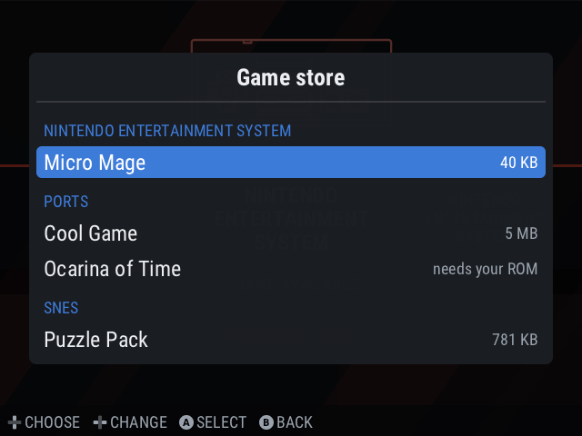
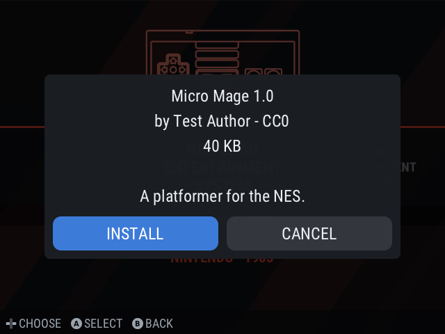
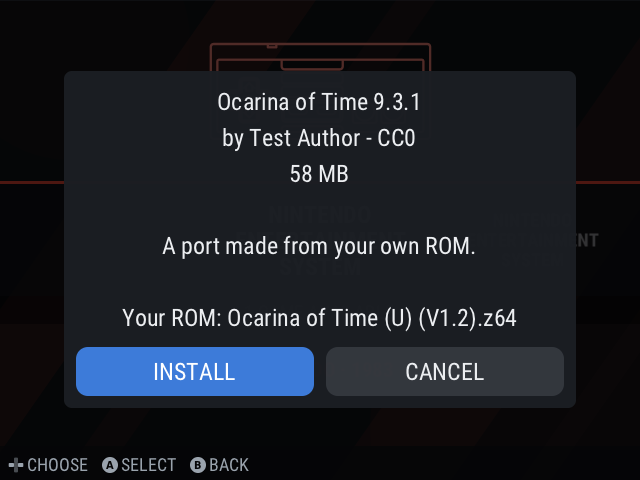
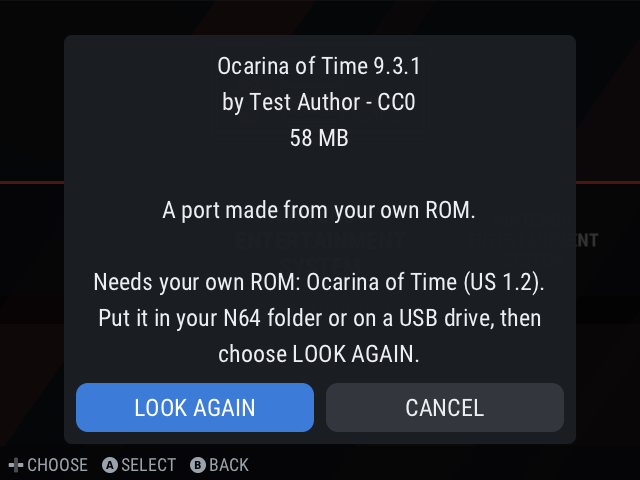
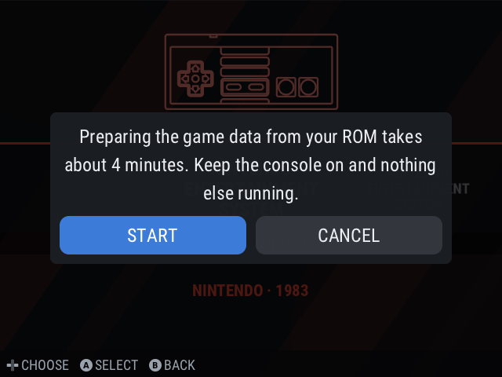
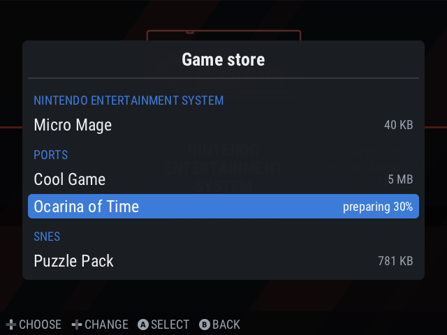

# Store (homebrew and freeware downloads) - design

Status: proposal, nothing implemented. Scope for v1: **homebrew and freeware only**. No commercial ROMs, no
ports that need Nintendo assets (those stay build-it-yourself in `ports/`).

## Goal
Settings-free, on-device browsing of a signed catalog: pick a system or "Ports", see entries with cover, size
and description, press A to download, play from the normal game list.

## Reuse (already in the tree)
| Need | Existing piece |
|---|---|
| HTTPS download with range/resume, timeouts | `frontend/src/update/http.c` (`http_get`, mbedTLS) |
| JSON catalog parsing | `update/json.c` |
| Integrity | `update/sha256.c` |
| Authenticity | `update/rsu.c` signify-compatible Ed25519 (`manifest.sig`), same trust model as OTA |
| Long job with progress and cancel | `rsos-covers` helper: runs as its own process, writes a progress file, SIGTERM cancels; UI polls it (`ui/storage.c`) |
| Destination choice | game libraries (SD / eMMC / M.2) from `loader.c` and the "Copy games to" import screen |
| Covers | `rsos-covers` / `apply_covers` and `roms/native/media/covers/` |

## Pieces
1. **Catalog** (`catalog.json` + `catalog.json.sig`), static files on GitHub Pages or Releases. Signed with a store
   key kept separate from the OTA key, public key built in (`BR2_RETROSTONE_STORE_PUBKEY`, same pattern as the
   update repo/key options).
2. **`rsos-store` helper** (new, `update/rsos-store.c`): subcommands `list`, `get <id> <dest>`, `verify`.
   `get` downloads to `<dest>/.store-tmp`, checks size and SHA-256, unpacks, then renames into place, so a
   cancelled or failed download never leaves a half game. It writes the progress file in the `rsos-covers` format.
3. **Frontend screen** (`ui/store.c`): a "Store" entry beside Settings. System tabs, list with installed marker,
   detail view, destination picker reusing the library chooser, Update/Remove for installed entries.
4. **Install record**: `/data/rsos/store/installed.json` (id, version, files), so updates and Remove work and
   other tools never have to guess what the store put on the card.

## Catalog entry
```json
{ "id": "micro-mages", "name": "Micro Mages", "system": "nes", "version": "1.2",
  "license": "freeware, author-permitted redistribution", "author": "Morphcat Games",
  "desc": "...", "size": 41040, "sha256": "...", "url": "https://.../micro-mages.nes",
  "cover": "https://.../micro-mages.png",
  "kind": "rom" }
```
`kind` is `rom` (single file, goes to `roms/<system>/`), `zip` (extract into `roms/<system>/`), or `native`
(archive with a `Name.sh` launcher + data, goes to `roms/native/`; arch must be `armhf` and the `.sh` is shown
before install). Every entry carries a `license` string and a `source` URL; the catalog tooling refuses an entry
without them.

## Safety rules
- Catalog signature checked before anything is parsed; entries signed as a whole, so a swapped URL fails.
- Download size capped by the catalog's `size`; extra bytes abort. SHA-256 checked before unpack.
- Archive extraction rejects absolute paths, `..`, symlinks and device files; files land only under the chosen
  library's `roms/<system>/` (or `roms/native/`).
- `native` entries run code, so the store requires the signed catalog and the install screen shows author and
  license first. No catalog entry can touch the read-only rootfs.
- Works with WiFi off: the screen says so and offers "Turn WiFi on" (existing Network setting).

## Content sourcing (v1)
Only titles whose licence allows redistribution: public-domain homebrew, Homebrew Hub (checking each licence),
itch.io freeware that permits it, and open-source native games that cross-build on the A20. Each added with the
author's licence recorded. Port build scripts stay in `ports/` and are linked from the store as "How to build",
not downloaded.

## Server side
- `store/` directory in the fork (or a separate repo): `entries/*.toml` -> `make-catalog.py` -> `catalog.json`,
  hashes the files, signs with the store key. GitHub Actions publishes to Pages.
- Entry files are mirrored on our release page so a third-party site vanishing does not break a download.

## Milestones
1. Catalog format + `make-catalog.py` + signing + host tests (golden catalog, tamper cases).
2. `rsos-store` helper: list/get/verify; tests with a local HTTP server and malicious archives.
3. UI screen using `rsos-uipreview` for screenshots, then hardware test over the Dev SSH card.
4. Seed catalog with ~10 licence-checked titles; release as a fork build (0.1.5.21).
5. Upstream PR as its own feature (maintainer asked one feature per PR), after the fork build is hw-tested.

## Open points
- Store key custody and the fork vs upstream catalog URL (build option, like the OTA repo).
- Whether upstream wants a store at all; fork build works either way.
- Cover size/format limits for catalog images (match the current 640x480 title style).

## Implementation notes (as built, milestones 1-2)
- Archives are plain **ustar** tar (`tar --format=ustar`), not zip: the helper unpacks them itself, with no extra
  library. Regular files and folders only; links, `..`, absolute paths and unpacked bytes beyond the catalog's
  `unpacked` are refused.
- The catalog is signed with `rsos-mkupdate signfile` / checked with `verifyfile` (signify-compatible, same code as
  the updater); `scripts/store/make-catalog.py` builds `catalog.json` from `entries/*.json` and refuses an entry
  without a licence or source.
- `native` entries carry `arch` and are hidden unless it matches the console's (`armhf`).
- `rsos-store` is `frontend/src/update/rsos-store.c` (`list`, `get`, `remove`, `installed`); tests:
  `frontend/src/update/tests/store_test.sh` (40 checks, run by `make check-update`).
- The store's public key goes to `/usr/share/rsos/store.pub` (`RSOS_STORE_PUBKEY`, default `assets/store.pub`;
  the key pair is not generated yet) and the catalog URL is `RSOS_STORE_URL`.

## Idea: ports from the user's own ROM
Proposed 2026-11-06: if the ROM is already in the user's N64 folder, offer "Install <port>", which makes the
port, adds it to Ports and removes every temporary file.
- **Compiling on the console is not realistic**: the image has no compiler (read-only rootfs), the ports need
  hours of build time and more than the A20's 1 GB of RAM for the C++ ones.
- **Realistic version**: the store ships the port's prebuilt `armhf` binary *without* assets (that is legal to
  host). The device then does the one step that needs the user's ROM: check its SHA-1 against the port's list,
  extract the game assets into the port's `.o2r`/data files with a small extractor, add the launcher to Ports,
  and delete the temporary files. That needs the extractor built for armhf per port (SoH/2Ship use ZAPD, Starship
  Torch; SM64 builds assets at compile time and would need its own packer).
- Catalog support: a new entry kind `port` with `rom_sha1` list, `extract` command and the asset-free archive.
- Open: measure the extractor's time and memory on the A20 (PC: SoH ~19 s).

## Milestone 3 (built): Settings > Game store
`frontend/src/ui/store_ui.c`: the helper's catalog as a menu grouped by system ("Ports" for native games), a
game's page (description, author, licence, size) with INSTALL / UPDATE / REMOVE, a drive choice when the console
has several game drives, download progress as a percentage, translated error messages (full drive, existing
file, damaged download, invalid package). Preview tests: `tests/fake-rsos-store.sh` + `make check-ui`.

## Idea (2026-11-06): a "Store" tile on the main carousel
Appears only while the console is online; opens the same list, with a cover and description per game and a
category (console) level when the list is long. Needs: a pseudo-system entry in the carousel (like Favorites),
theme art for it, a list view with covers (the catalog already carries a `cover` URL; thumbnails would be fetched
on demand and cached), and the console categories as the first level.

See also [store-ports.md](store-ports.md): installing ports from the user's own ROM (design, 2026-11-06).

## Screens (preview tool, fake helper)
| | |
|---|---|
|  |  |
|  |  |
|  |  |
